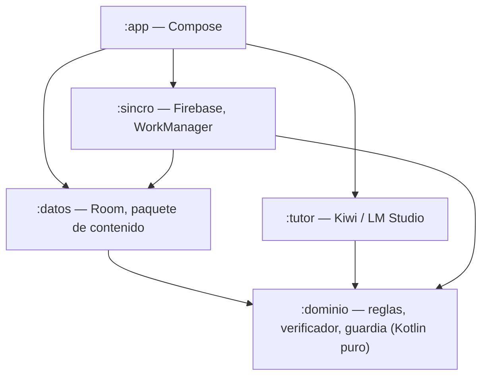

# Prepárate — Android

App Android nativa para preparar el examen de admisión a 8.º de EGB. Para estudiantes de 11 a 12 años, con
temas cortos, pruebas por sección, examen final y **Kiwi**, un tutor que ayuda a razonar sin dar la respuesta.

- Funciona **sin Internet**: el progreso vive en el dispositivo (Room) y se copia en Firebase cuando hay red.
- Cada estudiante tiene su cuenta y su progreso, también en un dispositivo compartido.
- Pensada para tablet (Huawei MatePad 11.5, **sin servicios de Google**) y adaptada al celular.

Visión y alcance: [`docs/vision.md`](docs/vision.md) · Arquitectura: [`docs/arquitectura.md`](docs/arquitectura.md) ·
Decisiones: [`docs/adr/`](docs/adr/README.md)

## Arquitectura en una imagen



| Módulo | Qué hace |
|---|---|
| `dominio/` | Reglas del curso, verificador, cuaderno, selección, repasos, guardia de Kiwi y nota del Writing. Sin Android |
| `datos/` | Room y lectura del paquete de contenido |
| `tutor/` | Cliente de LM Studio, prompts y servicio de Kiwi. Sin Android |
| `sincro/` | Subida, descarga y unión con Firestore; cuentas y panel de admin |
| `app/` | Pantallas Compose y navegación |
| `herramientas/` | Scripts de PC: cuentas (`cuentas.py`) y traspaso desde la web (`traspasar.py`) |
| `pruebas-reglas/` | Tests de `firestore.rules` con el emulador de Firebase |

## Cómo compilarlo en 5 minutos

Requisitos: Android Studio (trae el JDK 21 en `jbr/`) con el SDK 36, y el archivo `app/google-services.json`
del proyecto de Firebase (no está en git; pídelo al responsable).

```bash
git clone https://github.com/Jagr-ecu/repaso-admisiones-android.git
```

```bash
cd repaso-admisiones-android
```

```bash
npm install
```

`npm install` instala solo el hook que revisa los mensajes de commit (husky + commitlint).

```bash
./gradlew :app:assembleDebug
```

El APK queda en `app/build/outputs/apk/debug/app-debug.apk`. En Windows, usa el JDK de Android Studio:
`JAVA_HOME="C:\Program Files\Android\Android Studio\jbr"`.

## Cómo probarlo

| Qué | Comando |
|---|---|
| Lógica del dominio (JVM, rápido) | `./gradlew :dominio:test` |
| Kiwi: puerta de ayuda, guardia, Writing (JVM) | `./gradlew :tutor:test` |
| Todos los tests de la JVM | `./gradlew test` |
| Formato, detekt, lint y tests (antes de cada PR) | `./gradlew check` |
| Corregir el formato | `./gradlew spotlessApply` |
| Room, sincronización y migraciones (emulador abierto) | `./gradlew :datos:connectedDebugAndroidTest` |
| Reglas de Firestore (emulador de Firebase) | `cd pruebas-reglas && npm install && npm test` |

## APK firmado

`./gradlew :app:assembleRelease` necesita `keystore.properties` en la raíz (formato en `app/build.gradle.kts`).
Sin él, el APK sale sin firmar y no se puede instalar. La clave de firma nunca va en git.

## Contenido

Las preguntas no están en el código: se generan en el proyecto web (Python) con `exportar-paquete` y se guardan en
`app/src/main/assets/contenido/`. Ver `CLAUDE.md`, sección "Comandos".

## Contribuir

Flujo de ramas, commits y Definition of Done en [`CONTRIBUTING.md`](CONTRIBUTING.md).
Seguridad: [`SECURITY.md`](SECURITY.md).

## Licencia

Código privado. Todos los derechos reservados. Ver [`LICENSE`](LICENSE).
