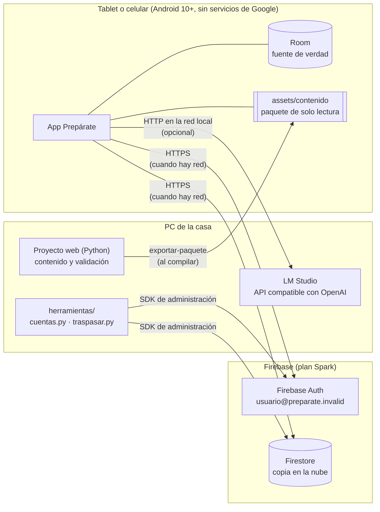
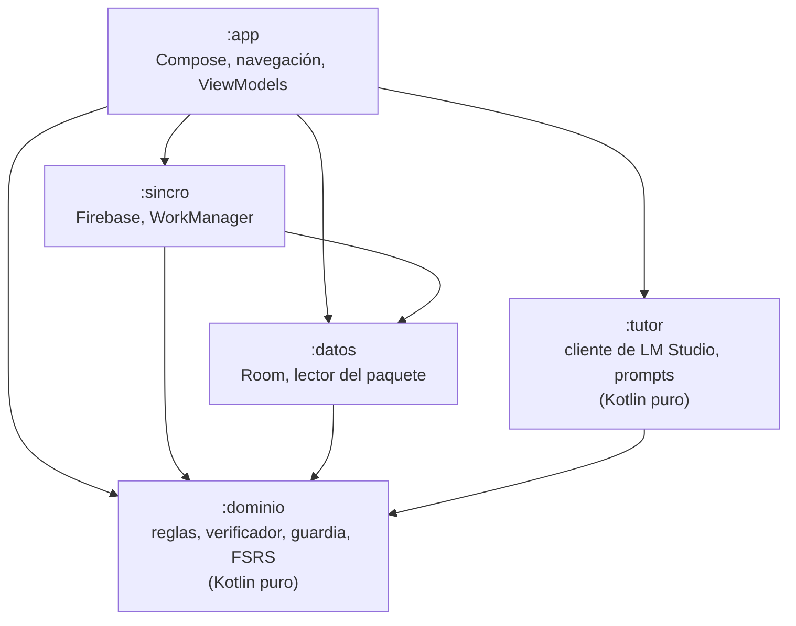
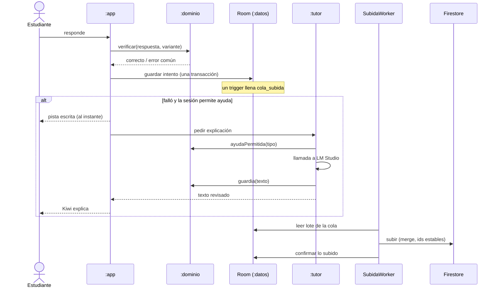

# Arquitectura

Estado: vigente. Cada decisión enlaza su [ADR](adr/README.md).

## Vista general

La app no tiene servidor propio. El dispositivo es la fuente de verdad y la nube guarda una copia.



- Sin Internet: todo funciona salvo la sincronización.
- Sin LM Studio: todo funciona salvo Kiwi y la calificación de Writing, que queda pendiente.

## Módulos de Gradle



| Módulo | Responsabilidad | Android | Tests |
|---|---|---|---|
| `:dominio` | Reglas del curso, camino, verificador, cuaderno, selección, repaso FSRS, guardia de Kiwi, nota del Writing, unión de la sincronización, panel | No | JVM y casos de referencia de Python |
| `:tutor` | `ClienteKiwi`, `Prompts`, `Tutor`. Consulta `ayudaPermitida` antes de cada llamada | No | JVM, con un test por tipo de sesión |
| `:datos` | Room (sesiones, intentos, memoria, puntos, cola de subida), `Estudios`, `LectorContenido` | Sí | Dispositivo o emulador |
| `:sincro` | `Sincronizacion`, `SubidaWorker`, `Cuentas`, `PanelAdmin` | Sí | Dispositivo o emulador |
| `:app` | Pantallas Compose, `WindowSizeClass`, KaTeX en WebView | Sí | Manual en emulador y MatePad |
| `:arquitectura` | Solo tests: comprueba con Konsist las reglas de dependencias, el filtro por `usuario_id` y que no se guarde el chat de Kiwi | No | JVM ([ADR-0017](adr/0017-tests-de-arquitectura-con-konsist.md)) |

**Regla de dependencias:** todo apunta hacia `:dominio`, que no depende de nada de Android. Así la lógica
que decide notas, respuestas y bloqueos se prueba rápido y se compara con Python
([ADR-0006](adr/0006-dominio-kotlin-puro.md)). `./gradlew :arquitectura:test` lo comprueba en cada `check`.

## Flujo de una respuesta



## Decisiones y su justificación

| Área | Decisión | Por qué | ADR |
|---|---|---|---|
| Plataforma | Kotlin y Compose nativos | Sin conexión, una sola base para tablet y celular, control del WebView de fórmulas | [0001](adr/0001-kotlin-y-compose-nativo.md) |
| Datos | Room como fuente de verdad, Firestore como copia | La app debe funcionar sin red; la nube solo respalda y permite otro dispositivo | [0002](adr/0002-room-fuente-de-verdad.md) |
| Nube | Firebase en el plan Spark, sin Cloud Functions | Costo cero; Auth y Firestore cubren cuentas y copia | [0003](adr/0003-firebase-plan-gratuito.md) |
| Dispositivo | Sin servicios de Google, APK directo | La MatePad no los tiene; Firebase Auth y Firestore funcionan igual | [0004](adr/0004-sin-servicios-de-google.md) |
| Contenido | Paquete generado en Python dentro del APK | Sin intérprete ni SymPy en Android; respuesta calculada por código | [0005](adr/0005-contenido-dentro-del-apk.md) |
| Lógica | `:dominio` en Kotlin puro con casos de referencia | Tests rápidos; Kotlin y Python corrigen igual | [0006](adr/0006-dominio-kotlin-puro.md) |
| Tutor | LM Studio en el PC, sin RAG | Gratis y privado; el material de cada concepto cabe en el prompt | [0007](adr/0007-kiwi-con-lm-studio-local.md) |
| Ayuda | `ayudaPermitida(tipo)` como única puerta | Una sola regla, probada, para bloquear Kiwi y pistas en pruebas | [0008](adr/0008-ayuda-permitida-unica-puerta.md) |
| Privacidad | Conversaciones solo en memoria | Datos de menores; la guardia es la protección | [0009](adr/0009-conversaciones-sin-guardar.md) |
| Versiones | `minSdk` 29, `targetSdk` 36 | HarmonyOS 4.3; sin permiso de red local todavía | [0010](adr/0010-minsdk-29-targetsdk-36.md) |
| Modelo | Todo el progreso con `curso_id` | Los ids solo son únicos dentro de su curso | [0011](adr/0011-cursos-aislados.md) |
| Cuentas | Usuario y clave con `@preparate.invalid` | Sin correos reales de menores; sin registro público | [0012](adr/0012-login-con-dominio-invalid.md) |
| Fórmulas | KaTeX dentro de un WebView | El contenido usa LaTeX avanzado; se ve igual que en la web | [0013](adr/0013-katex-en-webview.md) |
| Repasos | FSRS portado de py-fsrs | No hay librería oficial en Kotlin; el traspaso exige las mismas fechas | [0014](adr/0014-fsrs-portado.md) |

## Datos en Firestore

```text
usuarios/{uid}                      nombre, usuario y rol; solo lo escribe un admin
estudiantes/{uid}/resumen/panel     lo que el admin ve primero
estudiantes/{uid}/sesiones/{uuid}
estudiantes/{uid}/intentos/{uuid}
estudiantes/{uid}/puntos/{motivo_referencia}
```

`memoria` (repaso espaciado) no se sube: se reconstruye en orden desde los intentos. Las reglas de unión están en
`PLAN-MIGRACION.md`, sección 4, y en `dominio/.../Union.kt`.

## Límites de confianza

| Frontera | Qué la protege |
|---|---|
| App ↔ Firestore | Firebase Auth y `firestore.rules`, probadas con el emulador |
| App ↔ LM Studio | Red local por HTTP sin cifrar (permitido en toda la app); la guardia revisa cada texto antes de mostrarlo |
| PC ↔ Firebase (scripts) | Credencial del SDK de administración, solo en el PC |
| Estudiante ↔ su dispositivo | Ninguna: el bloqueo de ayuda y el reloj viven en la app (riesgo aceptado, ADR-0008) |

El modelo de amenazas completo, con STRIDE en cada frontera, está en [`security/threat-model.md`](security/threat-model.md).
